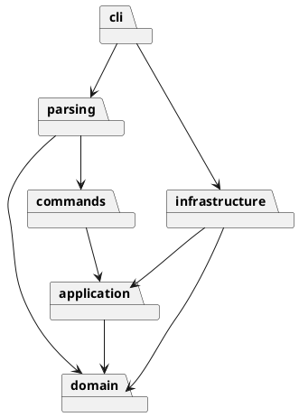

# Lab1 Phase 1：SVG 编辑器（CLI）

## 架构方案（开发前记录）

采用 TypeScript 面向对象实现，类独立成文件。

| 模块 | 职责 |
|---|---|
| domain | Shape 抽象、六种图形、文档树及结构不变量 |
| application | 编辑会话、命令历史、文件端口 |
| commands | 每条命令的独立实现，编辑命令统一事务与撤销逻辑 |
| parsing | 引号词法分析、命令注册、图形工厂 |
| infrastructure | XML 解析与序列化、文件系统实现 |
| cli | 逐行读取、输出和组合依赖 |

Command 模式统一 execute/undo/redo；Composite 让容器和叶子提供相同编辑接口；Memento 保存每条编辑命令前后的文档快照。文件系统与 SVG 编解码通过端口注入，domain 不引用 Node.js、CLI 或 XML 库。

依赖只按图中方向流动。命令名与图形类型名的分派分别集中在 CommandRegistry 与 ShapeFactory，标记为后续插件阶段的待重构项，避免在其他模块分散 switch(tag)。

## 过程记录

1. 2026-10-31：读取课程附件，确认本阶段只实现 rect/circle/ellipse/line/text/g，box 留到插件阶段。
2. 开发前决定：编辑命令先在文档副本上执行，成功后提交；失败不改变文档、文件路径和历史。IO 成功才设置 undo/redo 屏障。

实现完成后补充实际目录、验证结果与变化点说明。
