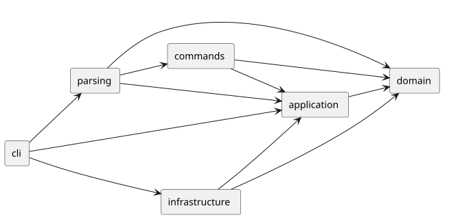
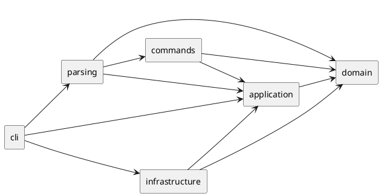

# Lab1 Phase 1：SVG 编辑器（CLI）

Git 仓库地址：**https://github.com/zhyy722/svg-editor-cli**

最终版本：[`final`](https://github.com/zhyy722/svg-editor-cli/tree/final)；开发过程见 [提交历史](https://github.com/zhyy722/svg-editor-cli/commits/master)。

本项目使用 TypeScript 面向对象方式实现 SVG 命令行编辑器。Phase 1 内置 `rect / circle / ellipse / line / text / g` 六种类型，实现课程要求的 19 个命令。`box` 和动态插件不属于本阶段，创建它们会返回 `unknown shape type`。

## 运行与验证

环境要求：Node.js 22 或以上，pnpm 10 或以上。本机使用 Windows、Node.js 24.22.1。以下命令在仓库根目录执行：

```sh
git clone https://github.com/zhyy722/svg-editor-cli.git
cd svg-editor-cli
git checkout final
pnpm install --frozen-lockfile
pnpm build
pnpm test
pnpm cli
```

也可使用 `npm install`、`npm run build`、`npm test`、`npm run cli`。为使用仓库中的锁文件准确复现依赖，推荐 pnpm。进入交互模式后，提示符为 `svg>`；Ctrl+C 或 EOF 退出。非交互管道输入省略提示符，仍逐行处理；发生单条命令错误后继续处理后续行。

回放课程流程图案例：

```sh
pnpm cli --script examples/flowchart.txt
```

生成的 [flowchart.svg](../examples/flowchart.svg) 可直接用浏览器打开。脚本中的每条命令及预期结构都可查看 [flowchart.txt](../examples/flowchart.txt)。

最小交互示例：

```text
init 400 200
create g flow
create rect start 30 70 120 60 #4a90d9 in flow
create text label 40 105 "开始" in flow
move flow 10 20
undo
redo
tree
save demo.svg
```

## 架构方案

### 模块划分

| 目录 | 主要类或接口 | 职责 |
|---|---|---|
| `src/domain` | `Shape`、`NumericShape`、六种图形、`SvgDocument` | 图形行为、多态操作、画布和文档树不变量；不承担 CLI、文件或 XML 处理 |
| `src/application` | `Session`、`History`、`Command`、`UndoableCommand`、`ShapeCreator`、`FileStore`、`SvgCodec` | 当前文档、文件路径、历史边界及输入输出端口 |
| `src/commands` | 每条命令对应的类、`EditCommand` 模板 | 将用户操作封装成命令；编辑事务、撤销与重做；`front/back` 共用 `ZOrderCommand` |
| `src/parsing` | `Tokenizer`、`Arguments`、`CommandRegistry`、`ShapeFactory` | 双引号、转义和参数校验；将名字映射到命令或图形实现 |
| `src/infrastructure` | `XmlSvgCodec`、`NodeFileStore` | XML 读写、缺 id 补全、支持的变换归一化、原子文件替换 |
| `src/cli` | `Main`、`Editor` | 组合依赖、REPL/脚本输入、格式化输出和统一错误出口 |
| `test` | 三组 Node.js 测试文件 | 应用行为、真实 CLI 与文件系统、架构约束回归 |
| `examples` / `doc` | 会话脚本、SVG、本文及 PlantUML | 可回放示例与设计依据 |

组件图箭头表示源码依赖方向。图由同目录 [architecture.puml](architecture.puml) 生成：





### 设计模式的选择与落地

**Command（必选）**：`Command.execute(Session)` 统一执行接口；每个操作由独立命令类表达。`CommandRegistry` 只负责构造命令，不负责修改图形。`MoveCommand`、`ScaleCommand`、`SetCommand` 等通过接收者的多态方法修改图形，避免按图形名称分支执行。

**Command + Memento**：编辑命令继承 `EditCommand`。每次操作先复制当前文档，在副本上执行；全部成功后才替换当前文档并记录历史。命令对象持有前后快照，`undo/redo` 恢复对应快照。一条多对象操作仍是一个撤销单元。该实现优先保证树结构与顺序准确恢复；代价是每条历史占用 O(N) 文档空间，后续可替换成增量补丁。

**Composite**：`Group` 与叶子都继承 `Shape`，统一提供 `move/scale/set/clone/describe`。`Group.move/scale` 递归调用子节点方法；命令不需要知道选中的是矩形还是分组。几何字段和样式字段封装在对象内部，`set` 校验属性白名单和数值范围；图形不是供外部任意修改的公共数据袋。

普通 `g` 的 `set fill/stroke/stroke-width` 设置容器自己的 SVG 样式，遵循 SVG 继承规则；子图形已有的显式样式仍优先。这里没有把普通分组擅自实现成后续 `box` 的插件专属传播语义。

**Factory 与端口/适配器**：`ShapeFactory` 通过内置注册表构造具体图形；`ShapeCreator` 隔开使用方与工厂实现。`Session` 依赖 `FileStore/SvgCodec` 接口，具体文件和 XML 实现由 `Main` 注入。测试使用内存文件端口，避免真实 IO 干扰撤销逻辑验证。

名字分派集中在 `CommandRegistry` 和 `ShapeFactory` 两处。两处均标注为下一阶段插件化的重构点；其余编辑逻辑不使用 `switch(tag)`。XML 里的 `translate/scale` 识别仅是输入格式解析，不承担按图形类型执行编辑行为的分派。

### 依赖方向规则

1. `domain` 只能依赖同模块，不依赖应用、命令、CLI、Node.js 或 XML 库。
2. `application` 只能依赖自身与 `domain`，通过接口描述外部能力，不引用具体编辑命令或适配器。
3. `commands` 可以依赖 `application/domain`，不能直接读写文件、调用 XML 库或解析命令行。
4. `parsing` 可以依赖 `commands/application/domain`；负责构造对象，不直接持有文件系统能力。
5. `infrastructure` 可以依赖 `application/domain`，实现端口；不能反向调用 CLI 或命令分发。
6. `cli` 作为组合根可引用以上入口和适配器。单个 `Editor` 只把解析结果交给命令执行，不包含图形编辑算法。

理由：把领域模型保持独立，使 GUI、agent 或新的存储方式不要求重写几何操作和撤销语义。`test/architecture.test.mjs` 遍历实际 import，违反这些规则时测试失败。

### 变化点假设

| 可能变化 | 当前准备或明确不做的理由 |
|---|---|
| 新图形、`box` 与插件注册 | 预留 `ShapeCreator` 接口、工厂注册表和 `Shape` 多态行为；不提前做动态加载、插件协议版本与完整 box 语义，避免越过阶段边界 |
| CLI 换成 GUI 或 agent | 编辑命令与 Session 独立于 readline；新入口可调用命令执行能力 |
| 更换 XML 库或文件存储 | `SvgCodec/FileStore` 端口隔离外部实现；当前同步 IO 适合单用户 CLI，不提前引入异步任务系统 |
| 大文档和长历史 | 快照撤销易于验证，但占空间；后续以增量 memento 替换 `EditCommand` 内部策略，暂不加未经要求的历史截断 |
| 任意 SVG/CSS/复杂变换 | 当前明确支持六种图形和数值几何属性，不声称是完整 SVG 编辑器；不支持的输入报错，避免静默丢失图形 |
| 树形与属性显示格式 | `Shape.describe/details` 与显示命令封装输出；没有为本阶段唯一的终端格式提前引入通用渲染插件 |

## 行为约定与范围说明

- id 全文档唯一、大小写敏感，不能为空或含空白。`create/group` 必须显式提供 id。外部 SVG 的已有 id 先整篇预扫描，再补缺失 id，避免与后面出现的 `rect1` 等冲突；警告只在读入整体成功后输出。
- `#` 仅在行首（允许前导空格）表示注释，颜色 `#4a90d9` 不会被截断。双引号支持带空格参数、空文本，以及 `\"`、`\\` 转义。
- `init` 默认 800×600，单独给宽度时高度仍为 600；`canvas` 查询不影响历史，修改尺寸需要宽高两个参数。
- `scale` 同乘全部位置与尺寸属性；普通编辑不会把文本内容、颜色和 `stroke-width` 当成几何值缩放。容器递归操作其全部后代。
- `front` 把元素放到同级序列末尾，因此绘制在最前；`back` 放到同级序列开头。
- `group` 不受参数排列顺序影响，保留原文档前序中的相对顺序；不同父容器的成员归到最低共同祖先，组插入最早成员所在分支的位置。禁止同时选择某容器与其后代。
- `addto` 移动到目标容器末尾，禁止自包含和祖先移入后代。`ungroup` 按课程要求拒绝 SVG 直接子容器；嵌套容器的子节点占据原容器位置。
- 成功的 `init/read/save/canvas 修改` 清空历史并设置 IO 屏障，直到下一次成功编辑解除。失败的编辑、解析、读写或尺寸修改，不改变文档、路径、undo/redo 栈。
- `save` 的默认路径是最近成功 `read/save` 的路径；新文档没有路径时要求显式参数。文件先写同目录临时文件，再原子替换目标。
- SVG 读写支持六种图形及各自参数、公共样式；文字额外保留导入的数值 `font-size` 与 `text-anchor`，但 CLI `set` 仍严格遵循课程白名单。根元素支持尺寸与 viewBox；根级渲染属性、未知图形/属性、DTD/实体、非均匀缩放和旋转等不支持。
- 支持导入 `translate`、正的均匀 `scale`，按 SVG 变换顺序归一化到几何坐标。保存结果保持本阶段支持的视觉与编辑语义，不保证保留原始 XML 空白、注释、版本或根 id。
- `tree/show/help` 不入历史；`help`、空行和注释可在没有文档时使用。其他依赖文档的命令未初始化时返回规定提示。
- 反馈保证摘要语义，不逐字复制附件 transcript：例如 `move` 输出增量 `moved by`，撤销输出 `undone: move id`。属性使用完整 SVG 名称 `width/height`，而非示例的 `w/h` 简写。

## 过程记录

以下仅记录本次实际开发与检查过程，不把 AI 的建议虚构为提交者已经手工审查过的过程。提交者提供了课程附件并选择公开仓库，AI 完成实现与自动化检查；提交前应自行回放示例、阅读关键类并确认方案。

| 步骤 | 实际问题或判断 | 确认与处理 |
|---|---|---|
| 需求分析 | 附件后半部分详细介绍 box，容易误当本阶段必做 | 对照 4.1、4.4 的阶段说明，只实现六种内置类型；测试验证 box 报 unknown type |
| 架构先行 | 先写代码再补设计容易掩盖实际依赖 | 首次提交先记录模块、方向、Command/Composite/Memento 决策，再提交领域模型 |
| 模型编译 | `Shape.isAncestorOf` 中 Group 与多态 this 的比较被严格类型检查拒绝 | 将遍历变量显式声明为共同基类 `Shape`，随后严格编译通过 |
| 命令事务 | 递归缩放可能先改一个子节点，后因另一节点数值溢出而失败 | 统一在文档副本执行；增加溢出回归，确认全部兄弟节点及历史保持原状 |
| 依赖修订 | 历史或 XML 适配器若依赖具体命令/工厂，会产生反向耦合 | 使用 `UndoableCommand`、`ShapeCreator` 应用端口；增加 import 方向检查 |
| 外部文件 | 边读边补 id 会抢占文件后面已有的 id | 改为先保留全文档显式 id；用“缺 id rect 在显式 rect1 前面”的案例验证得到 rect2 |
| IO 边界 | 保存失败不能像保存成功一样清空撤销历史 | 通过可失败内存端口与真实文件系统测试，验证失败不更新路径/历史 |
| 细节复查 | `Number('')` 会得到 0；空文本 show 可能丢失内容行 | 几何属性拒绝空字符串；Text 多态提供详情，显式显示 `text=""` |
| 端到端 | 单元测试通过不代表 CLI 接线正确 | 启动真实 Node 子进程回放命令，验证带空格路径、中文、错误后继续、保存再读回 |
| 可读性 | 最初紧凑代码不利于复核 | 统一使用 Prettier 格式化生产代码、测试与配置，并保留独立类文件 |

分步提交的真实历史包括：架构草案 → 多态图形与树模型 → 命令/历史/IO/CLI → 测试和边界修正 → 文档与最终整理。没有伪造过去的提交时间，也没有把所有代码拆成虚构的开发历史。

## 一致性自查

### 模块划分

实际六个生产模块与方案一致。增加的 `ShapeCreator/UndoableCommand` 接口属于 application 的端口与协议，已在上面的实际类清单及修订记录中说明。最终各生产类均单独成文件，文件名与类名一致；入口 `Main.ts` 只组合依赖和处理终端输入输出。

### 依赖方向

`test/architecture.test.mjs` 自动扫描所有生产文件：检查模块 import 方向；禁止 domain/application/commands/parsing 引入外部 IO/XML 依赖；检查每文件至多一个类、类名对应文件名，且无 `switch` 图形分派。检查已通过。

抽查：`MoveCommand` 仅依赖 `EditCommand` 与 domain；`History` 依赖应用层 `UndoableCommand` 接口；`XmlSvgCodec` 消费 `ShapeCreator/SvgCodec` 端口，不导入 parsing 的具体工厂；domain 未导入 Node.js。没有发现待处理的反向模块依赖。两处内置注册表的插件化仍是明确保留的后续重构项。

## 质量保证手段

1. TypeScript 严格模式，包括 `strict`、`noUncheckedIndexedAccess`、`exactOptionalPropertyTypes`、`noImplicitOverride`。
2. Node.js 内置测试器的 **21 项自动化测试**：本地全部通过。覆盖 19 个命令入口及六种图形，包含容器递归、顺序、撤销重做分支、IO 屏障、默认路径、原子失败、缺 id、XML 转义、中文和嵌套变换。
3. 真实 CLI 子进程与临时目录测试，避免只测试内部方法；验证输出文件确实存在、可读回，错误后仍继续处理。
4. 自动架构依赖与一类一文件检查，防止后续扩展破坏已声明规则。
5. 课程流程图脚本实际回放，生成 `examples/flowchart.svg`，树结构包含八个图形元素，移动容器后可整体撤销。
6. GitHub Actions 配置 Windows/Linux、Node.js 22 构建和测试；远程运行状态可在 [Actions](https://github.com/zhyy722/svg-editor-cli/actions) 查看，未将未运行的平台测试冒充本地结果。
7. 依赖锁定在 `pnpm-lock.yaml`，源码、示例、测试与文档均进入 Git；最后完成处创建并推送 `final` 标签。

测试侧重点是可观察行为与树不变量，不以测试数量代替完整性判断。当前不声称支持任意外部 SVG、插件动态加载、超大文档历史压缩或像素级渲染等尚未实现能力。
